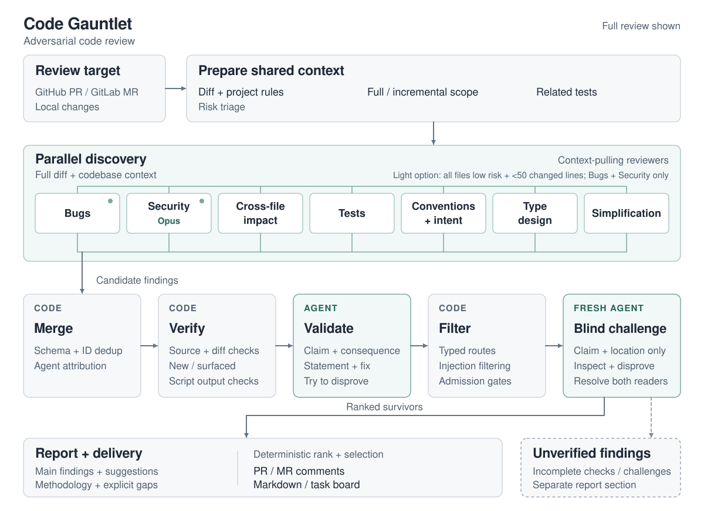

# Code Gauntlet

[](https://github.com/liatrio-labs/claude-code-gauntlet/actions/workflows/ci.yml)
[](LICENSE)
[](https://securityscorecards.dev/viewer/?uri=github.com/liatrio-labs/claude-code-gauntlet)

Code review for Claude Code where every finding has to survive a fight before you see it.

Up to seven specialist agents review each GitHub PR, GitLab MR, or local change for bugs, security, tests, and cross-file impact.
Each finding is then checked against the source, attacked by a skeptical validator, and re-examined by a blind challenger.
Only the survivors reach your PR.

On a public benchmark of real PRs with known bugs, v4 catches three in four of them, up from three in five for v3.
It does that without posting more comments ([benchmark results](#benchmark-results)).

<picture>
  <source media="(prefers-color-scheme: dark)" srcset="docs/assets/pipeline-overview-dark.svg">
  
</picture>

## What a finding looks like

This is a comment v4 wrote on [cal.com PR 8330](https://github.com/calcom/cal.com/pull/8330) during a benchmark run, trimmed to its first corroboration:

> **🟠 [HIGH] Date-override day short-circuits before the busy-time check, so busy slots are offered**
>
> When a slot falls on a day with a date override and is inside the override range, checkIfIsAvailable returns true immediately. It never reaches the busy.every(...) calendar and booking conflict check. On any override day, a host with an existing booking or calendar event still shows the slot as free. Fixed-host and loose-host paths both pass busy through this function, so double-bookings become possible.
>
> **Suggested fix:**
> Do not return early. Skip only the working-hours check when an override exists, then fall through to the busy check.
>
> **Corroborating finding — type-design-analyzer (type_design, confidence 98):**
> When any override matches the slot's date, checkIfIsAvailable returns true before reaching the busy.every(...) check. [...]
>
> ⚔️ *Code Gauntlet*

Four agents reported this bug independently, and the comment lists each one.
A review also gives you a summary of every reported issue and a full markdown report saved under `.code-gauntlet/`.

## Quick start

```bash
claude plugin marketplace add https://github.com/liatrio-labs/claude-code-gauntlet.git
claude plugin install code-gauntlet@code-gauntlet
```

Open Claude Code in your repository and enter `/code-gauntlet 42` to review PR #42.
PR and MR reviews need the `gh` or `glab` CLI logged in first.
Plain words work too, because the plugin triggers on code review requests:

```text
code gauntlet PR #42                  # GitHub pull request
review MR !89 thoroughly              # GitLab merge request
comprehensive review of my changes    # local uncommitted changes
```

The plugin detects GitHub or GitLab from the git remote.
It saves the report first, and interactive runs ask before posting anything to the PR or MR.
Update later with `claude plugin update code-gauntlet@code-gauntlet`.

### Requirements

- You need Claude Code 2.1.154 or newer, with git on your path.
- You need Python 3.10 or newer, reachable as `python3`, `python`, or `py -3`. There is nothing to `pip install`.
- You need an authenticated `gh` for GitHub or `glab` for GitLab to review PRs and MRs.
- Native Windows works with Git for Windows installed, which gives Claude Code its Bash tool.

A live headless run on Windows verifies local-changes reviews.
PR reviews on Windows are covered by Windows CI tests, not yet by a live forge review.

### Approving the pipeline

The review runs as one Claude Code workflow, and Claude Code asks you to approve it.
To approve it ahead of time, add this rule to `permissions.allow` in your Claude Code settings:

```json
"Workflow(code-gauntlet:code-gauntlet-pipeline)"
```

The rule covers this plugin's pipeline and no other workflow.
Add it if the approval prompt offers no way to say yes, which some Claude Code versions do for a script this large.
Headless runs need the same rule, or `--allowedTools` with the same value.

### Time and usage

The pipeline pins each review agent's model, so your session's model and effort do not change them.
Setting `CLAUDE_CODE_SUBAGENT_MODEL` is the exception, because it overrides every agent.
The session only prepares the review and delivers the result, so we recommend Sonnet at low effort for it.

In the v4 benchmark runs, a full review took a median of 9 minutes per PR, from 3 to 17.
Each review used a median of $5.32 at API prices, and 80% fell between $2.57 and $7.86.
Those runs used an Opus session. A Sonnet session uses less, by an amount we have not measured.

## How it reviews

A full review runs seven discovery agents in parallel:

| Agent | Model | Focus |
| --- | --- | --- |
| bug-detector | Sonnet | Logic errors, edge cases, error handling, defects in changed tests |
| security-reviewer | Opus | Trust boundaries, injection, authentication, attacker-controlled data |
| cross-file-impact | Sonnet | Callers and consumers the change can break elsewhere in the codebase |
| test-analyzer | Sonnet | Tests that are wrong or weak, critical coverage gaps, defects the tests expose |
| conventions-and-intent | Sonnet | Project rules, documented intent, comment accuracy |
| type-design-analyzer | Sonnet | Invariants, invalid states, type boundaries |
| code-simplifier | Sonnet | Simplifications that keep behavior, and defects found along the way |

The security reviewer runs on Opus, a judgment call that the [routing research](docs/research/artifacts/12-model-routing-for-code-review.md) explains.
When every changed file is low risk and the change is under 50 lines, the plugin offers a light review with only `bug-detector` and `security-reviewer`.

Agents see the full diff and follow callers, dependencies, and tests across files.
Discovery produces candidates, and each one then runs the gauntlet:

1. Merge combines duplicate findings and checks their structure.
2. Verify checks source facts in code and separates new issues from older ones.
3. Validate asks an independent skeptic to disprove each finding.
4. Filter applies confidence thresholds, rejects prompt injection, and groups related findings.
5. Admission is plain code that checks each finding has the evidence its kind requires.
6. Blind challenge asks a fresh agent to check the claim without the original reasoning or evidence.
7. Deliver gives each finding one final decision, ranks the survivors, and prepares comments and a report.

Admission holds test, type-design, and simplification findings to a higher bar, so they post only with proof.

A finding the challenger rejects is removed, unless it is a security finding, which is downgraded to a suggestion instead.
Weakly supported findings are downgraded to suggestions too, and a downgrade removes a finding already at the lowest severity.
Contested findings are kept and marked in the report.
If verification or validation itself breaks, the report records the gap.
The affected findings are held in the report's Unverified section and never posted.

Git blame separates new issues from older ones your changes exposed.
The older ones drop one severity level and carry an origin label.
After new commits, the plugin offers to review only what changed since the last review.

[How it works](docs/how-it-works.md) shows the full design, stage by stage.

## What it posts

The plugin saves a markdown report locally.
For an open PR or MR, it then asks whether to post the selected findings as inline comments.
GitHub receives them as one review, and GitLab receives a summary note plus one discussion per finding.
Findings about the same lines arrive as one comment that lists each agent's version.
A finding whose location cannot be confirmed stays in the review summary and gets no inline comment.

In interactive runs you can also create a task board for the selected findings.
Headless runs support chat, markdown, and PR/MR comments.
Headless posting defaults to dry-run and to six inline comments per review ([headless configuration](skills/code-gauntlet/references/headless-mode.md)).

## Configuration: REVIEW.md

Use `REVIEW.md` to set project rules, confidence thresholds, and findings to ignore.
Root settings apply project-wide, while matching subdirectory settings override thresholds and add ignores.

````markdown
## Rules
- All database queries must use parameterized statements

```yaml
# code-gauntlet
confidence_threshold: 75
ignore:
  - prompt injection via template tokens
```
````

Prose guides the agents, and the fenced config block controls thresholds and ignores.
No `REVIEW.md` is required. The default confidence threshold is 55, or 70 for security findings.
See the [configuration reference](skills/code-gauntlet/references/review-md-spec.md) for defaults and hierarchy, and the [authoring guide](docs/review-md-authoring.md) for writing rules.
The plugin also reads project rules from `CLAUDE.md`, `AGENTS.md`, and `QODO.md`.

## What it runs, reads, and sends

The plugin runs on your machine inside your Claude Code session. We operate no server and collect no data.

- It runs `git`, and `gh` or `glab` under your own login, to read the diff, the PR or MR, and earlier review comments.
- It reads the repository's rule files: `CLAUDE.md`, `AGENTS.md`, `QODO.md`, and `REVIEW.md`.
- It runs its own Python scripts, which use only the standard library and make no network calls.
- It sends the diff and the files the agents read to the model access you configured in Claude Code, and nowhere else.
- It writes review files under `.code-gauntlet/`, or the directory `CODE_GAUNTLET_OUTPUT_DIR` names. A rerun replaces the earlier files for the same commit.
- It adds one ignore entry to `.git/info/exclude` when that directory is inside the repository. It never edits your tracked `.gitignore`.
- It checks out the PR, MR, or branch under review in interactive runs when your working tree is elsewhere. That checkout can fetch the branch. Headless runs never check out.
- It posts to the PR or MR through `gh` or `glab`. Interactive runs ask first, and headless runs post only when configured to. Each post uses a temporary file that is deleted afterwards.
- It creates one Claude Code task per delivered finding if you accept the task-board offer.
- It ships no hooks, and the review agents can only read and search files. Two helper agents run the plugin's own scripts and write the review files.
- It has no telemetry, analytics, or tracking.

The plugin treats code under review as untrusted input and filters prompt-injection attempts.
Before posting comments, it escapes raw HTML and @mentions outside trusted code fences and redacts known GitHub and GitLab token formats.
See [security boundaries](SECURITY.md#trust-boundaries) and [PRIVACY.md](PRIVACY.md).

## Benchmark results

### v4.0 against v3.42

Scores come from the MIT-licensed [Martian code review benchmark](https://github.com/withmartian/code-review-benchmark): real PRs from open source projects, each with a list of known bugs.
Each release reviewed the same 15 PRs three times, and a pinned judge, `claude-opus-4-5-20251101`, scored both without knowing which release wrote a comment.
Recall is the share of known bugs a review catches. Precision is the share of posted comments that match a known bug.

| Measure | v3.42.49 | v4.0 | Change |
|---|---|---|---|
| Recall, 13 PRs with no overlap with our prompts (50 bugs) | 0.607 | 0.753 | +14.7 pts |
| Recall, all 15 PRs (66 bugs) | 0.581 | 0.747 | +16.7 pts |
| Recall, PRs outside our development subset (21 bugs) | 0.540 | 0.619 | +7.9 pts |
| Precision, 13 PRs | 0.327 | 0.463 | +13.6 pts |
| Inline comments per PR, all 15 PRs | 8.1 | 8.1 | none |

On the 13 PRs, the one-sided lower bound of the recall gain is +5.7 points.
The 21-bug gain is too small a sample to prove, and it shows no harm.
No bug that v3.42.49 caught in every run was missed by v4.0 in every run.

The benchmark lists only some of each PR's real problems, so a comment that matches no known bug is not a false alarm.
Two auditors from different model families checked 60 sampled v4.0 findings blind, and both marked all 60 grounded in the code.

Three limits apply.
The two releases ran three weeks apart on different Claude Code versions, with the same models.
Every run used an Opus session, and we have not benchmarked a Sonnet session.
The judge and the plugin both use Anthropic models, and same-vendor bias has not been measured here.

### Earlier epoch

The scores below use the older dfc6cb4-v1 / all epoch and do not compare with the table above.
They are the only runs that include other tools.
Noise is the share of reported findings the pinned judge rejects as ungrounded, vague, or incoherent.

<!-- bench-results:begin — this block is slated to be generated from the run ledger (issue #185); keep hand edits inside it minimal -->
| Release | Run | PRs | Golden recall | Noise rate | Tokens |
|---|---|---|---|---|---|
| v3.0 | gate subset | 15 | 0.695 | 0.180 | 20.9M |
| v3.0 | holdout | 10 | 0.741 | 0.209 | 17.8M |
| v2 (previous architecture) | gate subset | 15 | 0.492 | 0.164 | 41.1M |
| CodeRabbit (anchor) | gate subset | 15 | 0.627 | 0.566 (not comparable&dagger;) | — |
| Claude CLI review (anchor) | gate subset | 15 | 0.339 | 0.481 (not comparable&dagger;) | — |
| claude-code review (anchor) | gate subset | 15 | 0.271 | 0.542 (not comparable&dagger;) | — |

A later six-PR v3.26 run measured 0.667 recall and 0.138 noise.
At that size, one finding moves recall by 3.3 points.
Read it as a consistency check ([run history](bench/README.md#measurement-history)).
<!-- bench-results:end -->

Gate-subset rows cover the same 15 PRs under the same judge, and the holdout uses 10 different PRs.

&dagger; Anchors use stored upstream comments, not fresh tool runs.
Those comments lack file and line anchors, so they receive different scoring context, which can inflate anchor noise by an unmeasured amount.
Their noise rates are therefore not comparable. Recall is the comparable column.
See `adjudicator_context_note` in the [archived baselines](bench/golden/historical_baselines.json).

We run the benchmark by hand ([method](bench/MEASUREMENT.md)), not on every release.

## What's new in v4

- Each finding must carry the evidence its kind requires before it can be posted, and code checks that, not a prompt.
- One final decision sets whether each finding is posted, kept in the report, or held back.
- Findings that several agents report at the same lines arrive as one comment.
- The twelve agent prompts shrank from about 23,900 words to about 3,100.
- The `build-review-md` skill is retired, so write `REVIEW.md` by hand from the [authoring guide](docs/review-md-authoring.md).

[CHANGELOG.md](CHANGELOG.md) lists every release.

## Contributing

Start with [CONTRIBUTING.md](CONTRIBUTING.md) for setup, architecture, and checks.
[AGENTS.md](AGENTS.md) holds the repository rules and [docs/research](docs/research/README.md) the design evidence.
Report bugs and ask questions in [issues](https://github.com/liatrio-labs/claude-code-gauntlet/issues).

We formerly published the plugin as `deep-review`.

## License

[Apache 2.0](LICENSE)
