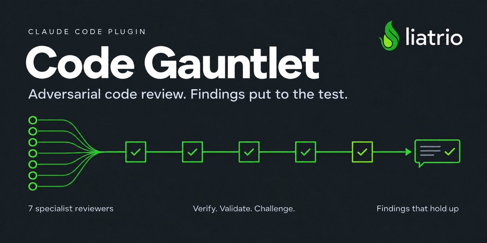
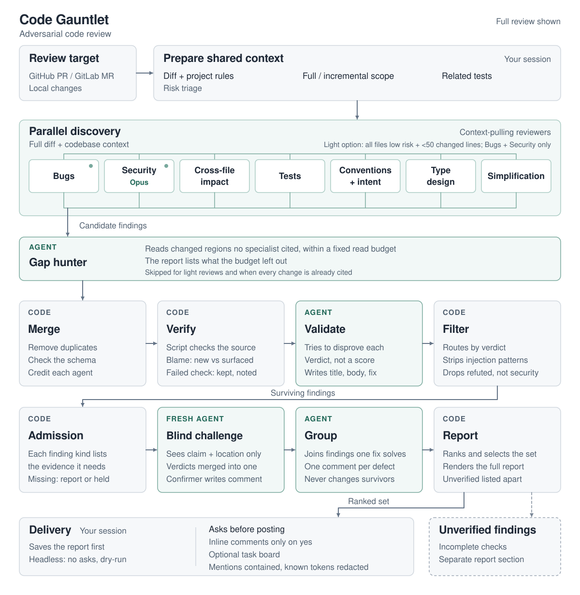

# Code Gauntlet

[](https://github.com/liatrio-labs/claude-code-gauntlet/actions/workflows/ci.yml)
[](LICENSE)
[](https://securityscorecards.dev/viewer/?uri=github.com/liatrio-labs/claude-code-gauntlet)



**Code review for Claude Code where every finding has to survive a fight before it reaches your PR.**

Code Gauntlet sends a team of specialist agents over your change, then tries hard to knock down everything they report.
What survives is a short list of findings that held up under that checking, each with one clear comment.

```bash
claude plugin marketplace add https://github.com/liatrio-labs/claude-code-gauntlet.git
claude plugin install code-gauntlet@code-gauntlet
```

## Why Code Gauntlet

- **It catches real bugs.** On a [public benchmark](#benchmark-results) of 15 real PRs with 66 known bugs, it caught 79% of them over three runs, and 73% on the PRs outside our tuning set. <!-- bench:pitch -->
- **Its findings hold up.** Each one is checked against the source, attacked by a skeptical validator, and re-examined by a blind challenger before it can post.
- **It keeps your PR readable.** When several agents report the same defect, you get one short comment, with a suggested fix when there is one.
- **It reviews where you work.** It handles GitHub PRs, GitLab MRs, and local changes, in your session or headless in CI.
- **It adds no service of its own.** It runs inside your Claude Code session and sends code only to your model provider and your PR. It has no telemetry, and it is Apache 2.0 licensed.

In a full review, seven specialist agents check the change for bugs, security, tests, and cross-file impact.
An eighth agent then reads changed code that none of their findings pointed at, within a fixed budget.
[How it reviews](#how-it-reviews) gives the detail.



## What a finding looks like

This is a comment it wrote for [cal.com PR 10600](https://github.com/calcom/cal.com/pull/10600) in a benchmark run.
Benchmark runs post nothing, so you will not find it on the PR.
Seven agents reported this race separately, and the plugin joined their reports into this one comment:

> **🟡 [MEDIUM] Backup code consumption is a non-atomic read-check-write, so concurrent logins can reuse a code**
>
> The code is checked against the list loaded earlier, then the whole re-encrypted list is written back with where {id}. Nothing makes the check and the write atomic. Concurrent logins with the same backup code can all pass before any write lands, so one code yields several sessions.
>
> **Additional sites:**
>
> - `line 144`
>
> ⚔️ *Code Gauntlet*

A review also gives you a summary of every reported issue and a full markdown report saved under `.code-gauntlet/`.

## Quick start

```bash
claude plugin marketplace add https://github.com/liatrio-labs/claude-code-gauntlet.git
claude plugin install code-gauntlet@code-gauntlet
```

Then open Claude Code in your repository and enter `/code-gauntlet 42` to review PR #42.
PR and MR reviews need the `gh` or `glab` CLI logged in first, and interactive runs review open PRs and MRs only.
A PR review checks out the PR branch and leaves you on it, so commit your work first.
Plain words work too, because the plugin triggers on code review requests:

```text
code gauntlet PR #42                  # GitHub pull request
review MR !89 thoroughly              # GitLab merge request
comprehensive review of my changes    # local changes, or this branch's PR if it has one
```

The plugin detects GitHub or GitLab from the git remote.
It saves the report first, and interactive runs ask before posting anything to the PR or MR.
Update later with `claude plugin update code-gauntlet@code-gauntlet`, and remove it with `claude plugin uninstall code-gauntlet@code-gauntlet`.

### Requirements

- You need Claude Code 2.1.154 or newer.
- Claude Code's workflows must be on. On a Pro plan, turn on Dynamic workflows in `/config`.
- The review agents run on Sonnet and Opus, so your Claude Code access must include both models.
- You need git on your path, and Python 3.10 or newer reachable as `python3`, `python`, or `py -3`. There is nothing to `pip install`.
- You need an authenticated `gh` for GitHub or `glab` for GitLab to review PRs and MRs.
- Native Windows works with Git for Windows installed, which gives Claude Code its Bash tool.

On Windows, reviews of local changes are tested end to end, and PR reviews are covered by automated tests only.

### Approving the pipeline

The review runs as one Claude Code workflow, and Claude Code asks you to approve it.
To approve it ahead of time, add this rule to `permissions.allow` in your Claude Code settings:

```json
"Workflow(code-gauntlet:code-gauntlet-pipeline)"
```

Add the rule if Claude Code rejects the workflow instead of asking.
The rule matches the pipeline's name, and a workflow in a repository's own `.claude/` directory can claim that name.
On a branch you do not trust, check what it adds under `.claude/` before you review it.

### Time and usage

The plugin sets each agent's model and effort, so your session's model and effort do not change them.
Two settings do change the models.
`CLAUDE_CODE_SUBAGENT_MODEL` overrides every agent, and `ANTHROPIC_DEFAULT_SONNET_MODEL` or `ANTHROPIC_DEFAULT_OPUS_MODEL` replaces that tier.
On Bedrock, Vertex, or Foundry, your deployment's model mapping applies.
The session only prepares the review and delivers the result, so we recommend Sonnet at low effort for it.

<!-- bench:cost:begin -->
The benchmark below ran from a session on Sonnet at low effort.
There, a review took a median of 12 minutes, from 4 to 22.
Claude Code's own cost estimate at API prices had a median of $4.97 per review, and 80% fell between $2.49 and $8.55.
<!-- bench:cost:end -->

On a subscription, the review counts against your plan's usage instead.
Larger changes take longer and cost more ([run history](https://github.com/liatrio-labs/claude-code-gauntlet/blob/v4.1.4/bench/README.md#measurement-history)).

## How it reviews

A full review starts seven specialist agents in parallel.
An eighth agent, the gap hunter, then reads any changed code that none of their findings pointed at:

| Agent | Model | Focus |
| --- | --- | --- |
| bug-detector | Sonnet | Logic errors, edge cases, error handling, defects in changed tests |
| security-reviewer | Opus | Trust boundaries, injection, authentication, attacker-controlled data |
| cross-file-impact | Sonnet | Callers and consumers the change can break elsewhere in the codebase |
| test-analyzer | Sonnet | Tests that are wrong or weak, critical coverage gaps, defects the tests expose |
| conventions-and-intent | Sonnet | Project rules, documented intent, comment accuracy |
| type-design-analyzer | Sonnet | Invariants, invalid states, type boundaries |
| code-simplifier | Sonnet | Simplifications that keep behavior, and defects found along the way |
| gap-hunter | Sonnet | Changed code that no specialist's finding pointed at |

The gap hunter works within a fixed read budget.
A coverage file saved beside the report records the changed code it did not reach.
It does not run when the specialists' findings already cover every change.

The security reviewer runs on Opus, a judgment call that the [routing research](https://github.com/liatrio-labs/claude-code-gauntlet/blob/v4.1.4/docs/research/artifacts/12-model-routing-for-code-review.md) explains.
The session rates each changed file's risk.
When every file is low risk and the change is under 50 lines, the plugin offers a light review.
A light review runs only `bug-detector` and `security-reviewer`, with no gap hunter.

Agents see the full diff and follow callers, dependencies, and tests across files.
Discovery produces candidates, and the gauntlet then checks them in this order:

1. Merge collects the agents' findings into one list, dropping malformed entries and repeated IDs.
2. Verify checks the cited files, lines, and symbols against the source.
3. Validate asks an independent skeptic to disprove each finding and return a verdict.
4. Filter routes each finding by that verdict and strips text that matches known prompt-injection patterns.
5. Admission is plain code that checks each finding has the evidence its kind requires.
6. Blind challenge asks a fresh agent to check the claim without the original reasoning or evidence.
7. Group joins findings that one change would fix, including one bug reported by several agents.
8. Report ranks the survivors, selects what to post, and renders the report.

The validator and challenger are the two readers of each finding.
They answer with a fixed verdict, such as confirmed failure, latent defect, or refuted, never a confidence score.
A latent defect is real but fails only after a future change or under an unusual condition.
Their two answers settle the final verdict.
A confirmed failure keeps its severity, and a latent defect drops to low severity.
A reader can refute a finding only by citing code, and the plugin checks that citation.
A security finding is dropped only when both readers refute it.
If only one reader refutes it, it stays in the report but is not posted.
Preferences, unverified findings, and complaints about comment wording stay in the local report.
If verification or validation itself breaks, the report records the gap.

Git blame separates new issues from older ones your changes exposed.
The older ones drop one severity level and are marked as pre-existing in the report.
When a PR or MR with a posted review gets new commits, an interactive run offers to review only what changed.
If the earlier reviewed commit is no longer in the branch history, it runs a full review instead.

[How it works](https://github.com/liatrio-labs/claude-code-gauntlet/blob/v4.1.4/docs/how-it-works.md) shows the full design, stage by stage.

## What it posts

The plugin saves a markdown report locally.
For an open PR or MR, it then asks whether to post the selected findings as inline comments.
GitHub receives them as one review, and GitLab receives a summary note plus one discussion per finding.
Findings that one fix would solve share one short comment, which lists the other places it applies.
The reader that confirmed the defect normally writes the comment: a title, one or two sentences, and a fix when it has one.
A finding whose location cannot be confirmed appears in the review summary without an inline comment.
In interactive runs you can also turn the selected findings into Claude Code tasks.

Interactive runs post every selected finding.
To limit them, set `CODE_GAUNTLET_PR_COMMENT_CAP` to the number of findings to deliver.

### Running headless

Headless mode runs a review with no questions, for CI and scripts:

```bash
CODE_GAUNTLET_HEADLESS=1 claude -p "/code-gauntlet 42"
```

A headless run never checks out a branch, so start it from a checkout of the PR's head commit, as CI does.
Otherwise it stops with an input error.
By default it posts nothing.
It saves the markdown report and, by default, selects up to 25 of the highest-ranked findings to deliver.
To post comments, set `CODE_GAUNTLET_DELIVERY=pr_comments` and `CODE_GAUNTLET_POST_MODE=live`.
It needs the workflow rule above plus permission to run git, `gh` or `glab`, and Python through Bash.
[Headless configuration](skills/code-gauntlet/references/headless-mode.md) lists every setting.

## Project rules

The plugin reads project rules as prose from `REVIEW.md`, `CLAUDE.md`, `AGENTS.md`, and `QODO.md`.
No `REVIEW.md` is required, and it holds rules only, not settings.
The [authoring guide](https://github.com/liatrio-labs/claude-code-gauntlet/blob/v4.1.4/docs/review-md-authoring.md) covers writing rules.

## What it runs, reads, and sends

The plugin runs on your machine inside your Claude Code session. We operate no server and collect no data.

- It runs `git`, and `gh` or `glab` under your own login, to read the diff, the PR or MR, and earlier review comments.
- It reads the repository's rule files: `CLAUDE.md`, `AGENTS.md`, `QODO.md`, and `REVIEW.md`.
- It runs its own Python scripts, which use only the standard library and reach the network only through `gh` or `glab`.
- It sends the diff and the files the agents read to the model provider you set up in Claude Code.
- The only other place it sends anything is your PR or MR, through `gh` or `glab`.
- It writes review files under `.code-gauntlet/`, or the directory `CODE_GAUNTLET_OUTPUT_DIR` names. They stay until you delete them, and a rerun replaces only the files for the same commit.
- It adds one ignore entry to `.git/info/exclude` when that directory is inside the repository and not already ignored. It never edits your tracked `.gitignore`.
- In interactive runs it checks out the PR, MR, or branch under review when your working tree is elsewhere, and leaves you on it. That checkout can fetch the branch.
- It posts to the PR or MR through `gh` or `glab`. Interactive runs ask first, and headless runs post only when configured to. Each post uses a temporary file that is deleted afterwards.
- It creates one Claude Code task per delivered finding if you accept the task offer.
- It ships no hooks, and the review agents can only read and search files. Two helper agents have more: one runs commands through Bash, and one writes the review files.
- It has no telemetry, analytics, or tracking.

The plugin treats code under review as untrusted input and strips text that matches known prompt-injection patterns.
Two things from the reviewed branch are trusted, as Claude Code trusts them: its rule files, and its `.claude/` settings, hooks, and workflows.
A branch can edit the rules that steer its own review, so check what an untrusted PR changes there first.
Before posting comments, the plugin escapes raw HTML and @mentions outside trusted code fences and redacts known GitHub and GitLab token formats.
See [security boundaries](SECURITY.md#trust-boundaries) and [PRIVACY.md](PRIVACY.md).

## Benchmark results

Scores come from the MIT-licensed [Martian code review benchmark](https://github.com/withmartian/code-review-benchmark): real PRs from open source projects, each with a list of known bugs.

<!-- bench:results:begin -->
We reviewed the same 15 PRs three times on Claude Code 2.1.323, from a session on Sonnet at low effort.
A pinned judge, `claude-opus-4-5-20251101`, scored every comment.

| Measure | v4.0 |
| --- | --- |
| Known bugs caught, all 15 PRs (66 bugs) | 78.8% |
| Known bugs caught, 13 PRs with no overlap with our prompts (50 bugs) | 80.0% |
| Known bugs caught, PRs outside our six-PR tuning set (21 bugs) | 73.0% |
| Comments that match a known bug (strict precision), all 15 PRs | 38.9% |
| Inline comments per PR | 9.3 |

Eleven of the PRs ran on a pre-release build.
The fixes made after it matter only for reviews with more than 40 findings, and the four PRs that large were rerun after the fixes.
Only the reruns count, and the [run history](https://github.com/liatrio-labs/claude-code-gauntlet/blob/v4.1.4/bench/README.md#measurement-history) lists what changed between the builds.
<!-- bench:results:end -->

The benchmark lists only some of each PR's real problems.
A comment that matches no known bug may still be valid, and we have not measured how many are.
The judge and the plugin both use Anthropic models, and same-vendor bias has not been measured here.

We run the benchmark by hand, not on every release.
The [run history](https://github.com/liatrio-labs/claude-code-gauntlet/blob/v4.1.4/bench/README.md#measurement-history) lists the runs behind these numbers, and the [method](https://github.com/liatrio-labs/claude-code-gauntlet/blob/v4.1.4/bench/MEASUREMENT.md) describes the scoring.

## Contributing

Start with [CONTRIBUTING.md](https://github.com/liatrio-labs/claude-code-gauntlet/blob/v4.1.4/CONTRIBUTING.md) for setup, architecture, and checks.
[AGENTS.md](https://github.com/liatrio-labs/claude-code-gauntlet/blob/v4.1.4/AGENTS.md) holds the repository rules and [docs/research](https://github.com/liatrio-labs/claude-code-gauntlet/blob/v4.1.4/docs/research/README.md) the design evidence.
Report bugs and ask questions in [issues](https://github.com/liatrio-labs/claude-code-gauntlet/issues).

## License

[Apache 2.0](LICENSE)
