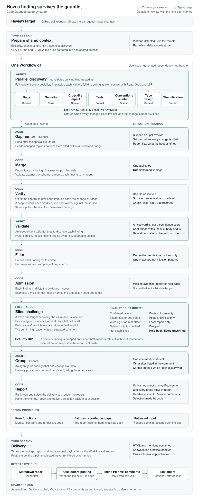

# How Code Gauntlet works

The [README](../README.md#how-it-reviews) gives the overview.
This diagram follows one finding through every stage.
It shows what each stage does to the finding, and whether code or an agent runs it.

<picture>
  <source media="(prefers-color-scheme: dark)" srcset="assets/pipeline-detail-dark.svg">
  
</picture>

The validator and the challenger answer with [fixed verdicts](../skills/code-gauntlet/references/validation-pipeline.md#validate-stage-validatestage), not confidence scores.
After blind challenge, a grouper joins findings that one change would fix.
Delivery posts one comment per defect, and grouping cannot change which findings survived.

Project rules come as prose from `REVIEW.md`, `CLAUDE.md`, `AGENTS.md`, and `QODO.md`.
They do not configure filtering or delivery ([format reference](../skills/code-gauntlet/references/review-md-spec.md)).
[CONTRIBUTING.md](../CONTRIBUTING.md#architecture) names each phase, and `workflows/src/` holds the stage modules, such as `mergeFindings.js` and `admission.js`.
